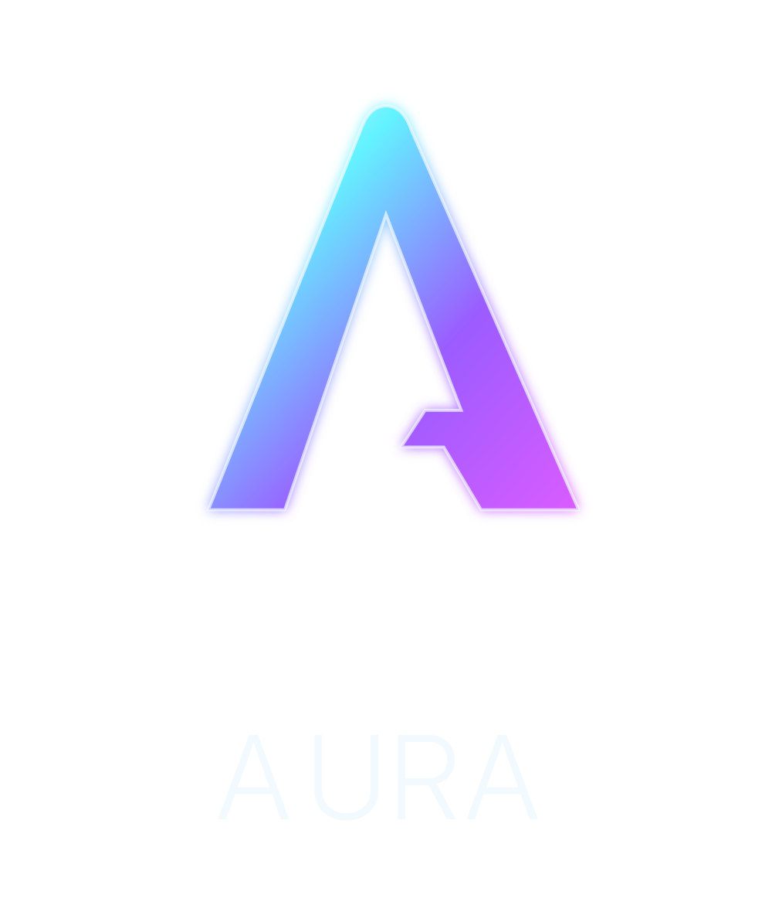

<div align="center">



# AURA — Neural Operating Interface

**A native, local-first AI desktop assistant for Windows.**  
**Un assistant IA natif pour Windows, conçu autour de la confidentialité et du contrôle utilisateur.**

[](#project-status--statut-du-projet)
[](#requirements--pr%C3%A9requis)
[](https://github.com/VeyrNova/AURA/issues)
[](LICENSE)

**[Report a bug / Signaler un bug](https://github.com/VeyrNova/AURA/issues/new)** ·
**[Suggest a feature / Proposer une fonction](https://github.com/VeyrNova/AURA/issues/new)** ·
**[Star AURA ⭐](https://github.com/VeyrNova/AURA)**

</div>

## Project status / Statut du projet

**Updated / Mis à jour : 23 October 2026 / 23 octobre 2026**

AURA is under active development. The **public repository contains source code and development material**, but it must not be confused with the latest validated local build.

- **Native Windows UI:** PySide6 + Qt Quick/QML; dark Liquid Glass visual direction.
- **Internal installation test:** a Windows per-user installer was installed, launched, uninstalled and reinstalled successfully on a separate local Windows account, preserving the tested user data.
- **Voice:** French Piper TTS was manually heard and tested in the source application, including playback stop, clean close during playback and persisted settings. Piper is an **optional, separately installed external runtime**.
- **Latest local standalone build:** BETA-002F-C1 (Nuitka) was built and passed its Qt/QML bootstrap smoke tests, but **several standalone Windows and audio acceptance tests remain pending**.
- **Public Windows installer:** **not released yet**. Please do not interpret internal build/test reports as a public download announcement.

> **FR :** AURA est en développement actif. Le code public, le build local de test et une future version bêta téléchargeable sont trois choses différentes. Aucun nouvel installateur bilingue n'est encore publié.
>
> **EN:** AURA is actively developed. Public source, locally tested builds, and a future downloadable beta are distinct. A bilingual installer has not yet been released.

## Features / Fonctionnalités

| FR | EN |
|---|---|
| Interface de bureau native avec navigation modulaire | Native desktop interface with modular navigation |
| Conversation avec fournisseurs IA configurables, notamment Gemini et Ollama | Conversation with configurable AI providers, including Gemini and Ollama |
| Mémoire et données locales par profil Windows | Per-user local memory and application data |
| Vision avec capture Windows et confirmation explicite avant transmission externe | Vision with Windows capture and explicit approval before external transmission |
| Entrée vocale Push-to-Talk et synthèse vocale locale optionnelle | Push-to-talk input and optional local speech output |
| Intégrations, outils et diagnostics selon leur disponibilité et leur configuration | Integrations, tools and diagnostics subject to configuration and availability |

Features may be experimental, unavailable in published source snapshots, or require separate accounts, credentials, compatible hardware or optional runtimes. **No provider credentials or paid API access are included.**

## Requirements / Prérequis

- **Windows 11** — tested target. Windows 10 compatibility is **not yet fully validated**.
- **Python 3.11** for development from source.
- **PySide6 6.11.2** and the project's declared Python dependencies.
- Optional external AI services require the user's own credentials; optional Piper requires a separately configured runtime and voice model.

### Running from source / Démarrer depuis les sources

These are development instructions, **not a supported public installer workflow**:

```powershell
python -m venv .venv
.\.venv\Scripts\Activate.ps1
python -m pip install -e ".[ui]"
python -m aura_native --self-check --state-dir "$env:TEMP\aura-native-selfcheck"
python app/main.py --windowed
```

Consult the repository's current scripts and documentation for environment-specific requirements. Local state defaults to `%LOCALAPPDATA%\AURA-NATIVE`; never commit that directory.

## French / English roadmap — Feuille de route FR/EN

These are **planned or in progress**, not already available in a public release:

- [ ] French and English language choice in the Windows installer.
- [ ] Complete French and English translations of the native AURA interface, including error messages and accessibility labels.
- [ ] Independent voice-language selection (FR/EN), with compatible user-selected voice models and explicit fallback when unavailable.
- [ ] Official multi-size Windows `.ico` integrated into the application, shortcuts, uninstall entry and installer.
- [ ] Finish the standalone acceptance matrix, with and without external Piper.
- [ ] Publish a clearly labeled, tested GitHub prerelease with checksums, known limitations and third-party notices.
- [ ] Perform a clean-Windows installation test, review redistributed dependencies and improve release signing.

## Feedback / Retours utilisateurs

**Help shape AURA / Aidez-nous à améliorer AURA.**

Please use [GitHub Issues](https://github.com/VeyrNova/AURA/issues) to report reproducible bugs, propose features, or discuss the experience. Include your Windows version, observed behavior, steps to reproduce and non-sensitive logs when possible.

**Never attach API keys, OAuth tokens, passwords, conversation exports, personal screenshots, user databases or private logs.**

If you want to follow the work, **[star the repository](https://github.com/VeyrNova/AURA)**. Stars support discoverability; they do not grant software usage rights.

## Architecture / Structure

- `app/` — desktop entry point and QML views
- `src/aura_native/` — services, provider adapters and Qt bridges
- `tests/native/` — focused tests for native runtime and functionality
- `docs/` — development milestones and test reports
- `packaging/` and `tools/` — packaging and build support

Older historical components remain in this repository; their presence does not imply they belong to the current native release or are all production-ready.

## Security & privacy / Sécurité et confidentialité

AURA is designed for local-first operation. External AI requests, optional voice engines and connected services depend on user configuration and their respective provider terms.

See [SECURITY.md](SECURITY.md). Never publish `%LOCALAPPDATA%\AURA-NATIVE`, credentials, keys, OAuth tokens, databases, logs, voice recordings, model binaries or generated installation artifacts as source-control files.

## License / Licence

**Copyright (c) 2026 Veyr. All rights reserved.**

This is currently a **publicly visible, proprietary source repository** — **not an open-source license**. Public access does not grant permission to copy, modify, redistribute, sell or run the software without the copyright holder's written permission. See [LICENSE](LICENSE) and [CONTRIBUTING.md](CONTRIBUTING.md).

Third-party dependencies and voice models retain their own licenses. Distribution of an installer requires separate review of all shipped components.
